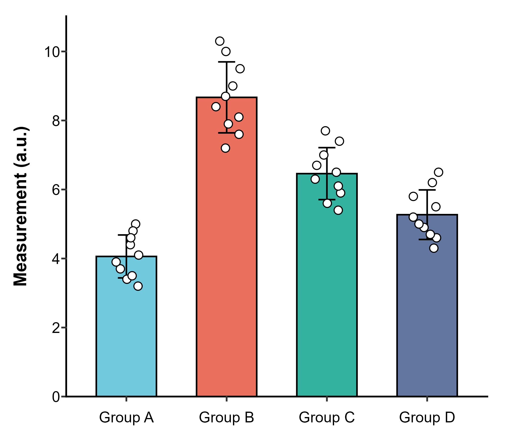
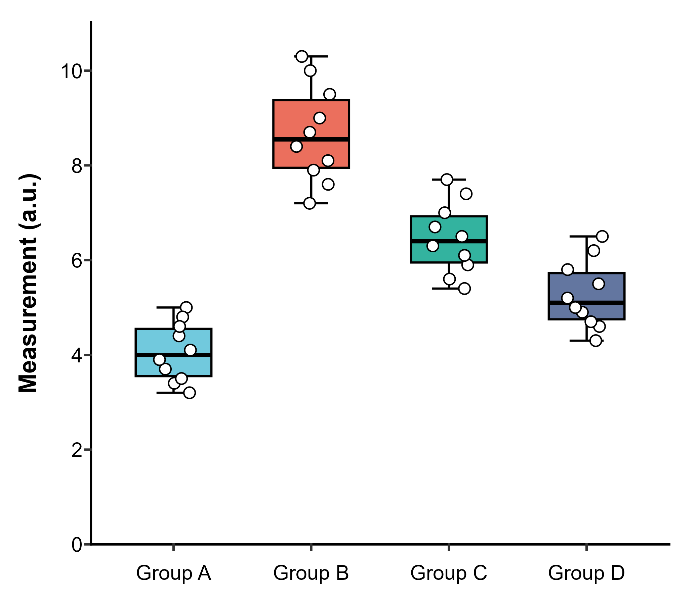
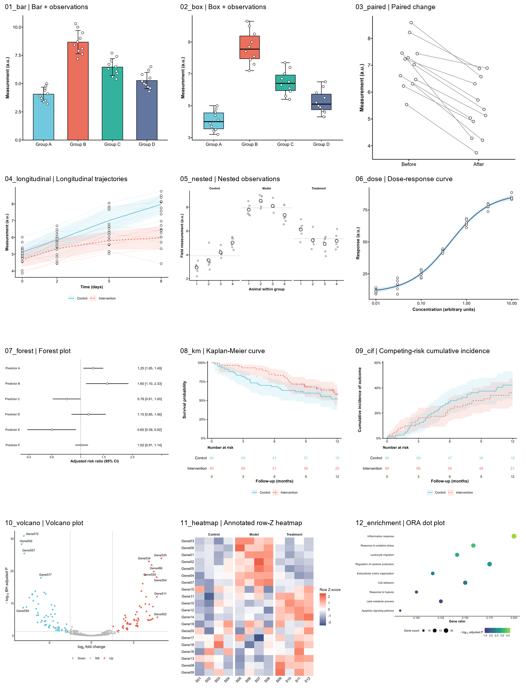
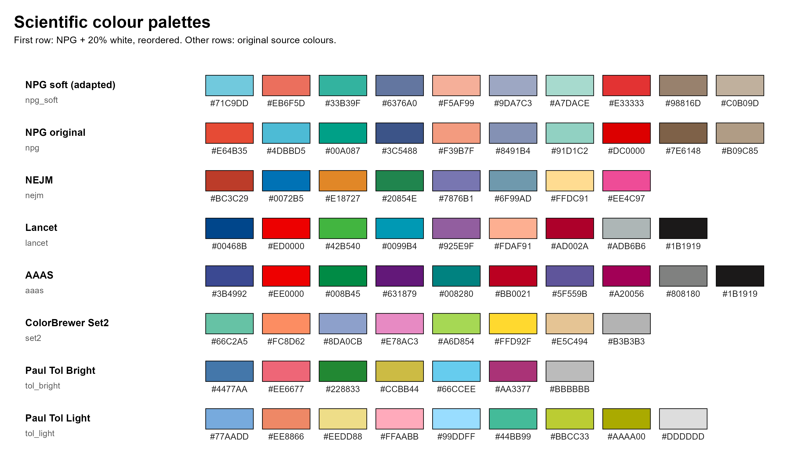

# ggplot Publication Figures

**Turn natural-language requests into consistent, reproducible scientific figures.**

English | [简体中文](README.zh-CN.md)

Prism-inspired styling · Visible observations · 8 reusable palettes · 12 runnable examples · 300 ppi PNG by default · optional PDF / SVG

A **Codex skill** that brings figure design, R code, visual review, and file delivery into a reusable workflow for experimental biology, clinical research, and bioinformatics.

[Quick start](#quick-start) · [Colour palettes](#colour-palettes) · [Example prompts](#example-prompts) · [Reproduce the gallery](#reproduce-the-gallery)

## See the results

<table>
  <tr>
    <td align="center"><b>Bars + individual observations</b></td>
    <td align="center"><b>Boxes + individual observations</b></td>
  </tr>
  <tr>
    <td></td>
    <td></td>
  </tr>
</table>

Both previews use **synthetic data**, with 10 observations per group. Bars show means ± sample SD. Boxes show medians and interquartile ranges, with whiskers extending to observations within 1.5 × IQR. The point layer shows every observation. The `npg_soft` palette is used throughout. Reproduce these plots with the [introductory example](examples/prism_style_demo.R).

## Experimental, clinical, and omics figures



| Experimental biology | Clinical research | Omics results |
| --- | --- | --- |
| Bars and boxes with individual observations | RR forest plot with 95% CI | Volcano plot with deterministic labels |
| Paired changes and longitudinal trajectories | KM curve with censor marks and a risk table | Row-Z heatmap with sample groups |
| Nested observations and dose–response curves | Competing-risk cumulative incidence with a risk table | ORA enrichment dot plot |

Explore the [complete gallery](examples/biomedical_gallery.md) for individual previews, synthetic-data descriptions, and code locations. Experimental plots use a Prism-inspired style. Clinical and omics figures use appropriate effect scales, risk tables, and continuous colour mappings.

Instructions load by task: [shared principles](references/core.md), [experimental figures](references/experimental.md), [clinical figures](references/clinical.md), [omics](references/omics.md), [imaging guidance](references/imaging.md), [composition](references/composition.md), and [delivery](references/delivery.md). The imaging module currently provides guidance for image handling and quantitative displays; runnable microscopy and Western blot examples are planned for future work.

## Why use this skill?

Repeating your preferences for point shapes, borders, fonts, colours, and export formats takes time. This project stores those choices alongside scientific plotting conventions so an agent can apply them across projects.

| What you need | The skill's defaults |
| --- | --- |
| A consistent visual style | Prism-inspired grouped plots: white background, black left/bottom axes, outward ticks, and readable text |
| Visible observations | Bars or boxes overlaid with circular, black-outlined, white-filled points |
| Clear, coordinated colours | Black bar and box outlines; `npg_soft` by default, with 7 alternatives |
| Clear statistical meaning | Experimental units, sample sizes, uncertainty, and comparisons described in context; pairing follows the study design |
| Reproducible revisions | Fixed layout seeds, explicit label and sorting rules, preserved values, and recorded display transformations |
| Selected export formats | Ask on every invocation; default to 300 ppi PNG; selected formats share one plot object |
| Correct figures in the report | Markdown / Obsidian embed paths and matching export files checked |

The references also cover GO / KEGG enrichment, GSEA, PCA, and correlation figures. Each figure family uses its own visual semantics. The Prism defaults primarily apply to grouped measurement data.

## Quick start

### 1. Install in Codex

Clone the complete repository into your user-level skills directory. [Codex's local skill discovery](https://developers.openai.com/codex/skills/) supports `~/.agents/skills/`.

**Windows / PowerShell**

```powershell
git clone https://github.com/Bostickk/ggplot-publication-figures.git `
  "$env:USERPROFILE/.agents/skills/ggplot-publication-figures"
```

**macOS / Linux**

```bash
mkdir -p ~/.agents/skills
git clone https://github.com/Bostickk/ggplot-publication-figures.git \
  ~/.agents/skills/ggplot-publication-figures
```

For an existing installation, update the copy in its current location. Then invoke the skill in a new Codex conversation:

```text
Use $ggplot-publication-figures to read my experimental data.
Create a Prism-inspired bar plot with individual observations,
the npg_soft palette, and mean ± SD. Export PNG, PDF, and SVG.
```

### 2. Prepare R

The examples use a local R installation and the following packages:

```r
install.packages(c("ggplot2", "ggprism", "ggrepel", "patchwork", "survival", "jsonlite"))
```

On every skill invocation, the agent asks which of PNG, PDF and SVG to produce. The default selection is **PNG only at 300 ppi**. Export follows your confirmation; another PNG resolution requires an explicit request.

`ggprism` supplies the preferred experimental theme; a plain ggplot2 fallback is available. Other tasks may require additional packages such as `dplyr`. The agent reads the skill and generates project-specific code. You can also use the palette functions and example scripts directly in R.

## Colour palettes

The default **`npg_soft`** mixes the original NPG colours with 20% white and reorders them for common grouped plots. Cyan, coral, teal, and slate blue remain distinct alongside black outlines and white-filled points.



| Name | Character and suggested use |
| --- | --- |
| **`npg_soft`** | Default; a lighter NPG adaptation for bars and boxes |
| `npg` | Original NPG palette with stronger colours |
| `nejm` | Balanced blue, red, orange, and green contrasts |
| `lancet` | Stronger contrasts using navy, red, and green |
| `aaas` | Deeper colours for higher-contrast displays |
| `set2` | Soft multicolour categorical fills |
| `tol_bright` | Paul Tol Bright, an option when prioritising colour-vision differences |
| `tol_light` | Paul Tol Light, for lighter fills with clear outlines |

Use the palette helper from the repository root:

```r
source("scripts/publication_palettes.R")

group_order <- c("Control", "Model", "Treatment A", "Treatment B")
group_colours <- setNames(
  get_publication_palette("npg_soft", length(group_order)),
  group_order
)

# For a ggplot whose fill aesthetic maps to these group names:
# + scale_fill_manual(values = group_colours)
```

Exact colours, sources, and adaptation details are recorded in the [palette guide](references/palette-guide.md) and [machine-readable palette bank](references/palette-bank.json). Journal names identify the palettes' inspiration. Review the actual figure for colour-vision accessibility, print appearance, and group separation.

## Example prompts

Copy a prompt and add your data path, groups, and units.

**Grouped experimental measurements**

```text
Use $ggplot-publication-figures.
Read data.csv: group identifies the group, animal_id identifies the animal,
and value contains the measurements. Each animal is an experimental unit.
Draw bars with individual observations and mean ± SD using npg_soft.
Keep observation points circular, black-outlined, and white-filled.
Save the R script and PNG/PDF/SVG files.
```

**Compare distributions**

```text
Use $ggplot-publication-figures.
Show grouped measurements as boxplots with every individual observation,
using set2. Describe the boxes and whiskers, preserve the paired design,
and state the effective sample size for each group.
```

**Visualise differential-expression results**

```text
Use $ggplot-publication-figures.
Create a volcano plot from my differential-expression results.
Use padj < 0.05 and |log2FC| > 1 as the DEG thresholds.
Apply the skill's deterministic label-selection rules, fix the layout seed,
and inspect extreme values and label clipping.
```

## Reproduce the gallery

From the repository root, run all 12 examples:

```bash
Rscript examples/biomedical_gallery.R
# Explicit format selection and PNG resolution:
Rscript examples/biomedical_gallery.R --formats=png,pdf,svg --ppi=300
```

The script creates `examples/biomedical-output/` with 12 PNG files at 300 ppi by default, synthetic observations and result tables in CSV, R session information, captions, and `manifest.json`. Data generation and layouts use fixed seeds. Analysis methods are described in the code and captions. The introductory two-plot example remains available through `Rscript examples/prism_style_demo.R`.

The examples have been run on Windows with R 4.5.3, ggplot2 4.0.2, and ggprism 1.0.7. Scripts use repository-relative paths. Check fonts and export devices in your own environment.

Use PowerShell to check figure embeds or PDF links, minimum file sizes, and the selected export formats. The validator defaults to PNG only. Add `-ExpectedFormats png,pdf,svg` for that explicitly selected combination:

```powershell
pwsh -File scripts/validate_figure_delivery.ps1 `
  -ReportPath examples/biomedical-output/report.md `
  -VaultRoot .
```

For an Obsidian report, set `-VaultRoot` to its actual vault root. Follow automated checks with visual review at full size and approximately 50% scale, including text, points, intervals, and labels.

## Project structure

```text
ggplot-publication-figures/
├── SKILL.md                         # Entry point and task-specific routing
├── references/                      # Experimental, clinical, omics, imaging, delivery
│   ├── palette-guide.md
│   └── palette-bank.json
├── scripts/
│   ├── biomedical_styles.R          # Prism / clinical / omics themes
│   ├── publication_palettes.R       # 8 fixed colour palettes
│   └── validate_figure_delivery.ps1
├── examples/
│   ├── biomedical_gallery.R         # Run all 12 figures
│   ├── biomedical_gallery.md        # Previews, captions, and code locations
│   ├── lib/                         # Export, experimental, clinical, and omics code
│   └── prism_style_demo.R           # Introductory two-plot example
├── assets/                          # Preview figures, overview, and palette catalogue
└── README.zh-CN.md                  # Chinese documentation
```

## Sources and contributions

Themes and palettes draw on [ggplot2](https://ggplot2.tidyverse.org/), [ggprism](https://csdaw.github.io/ggprism/), [ggsci](https://nanx.me/ggsci/), [ColorBrewer](https://colorbrewer2.org/), and [Paul Tol](https://sronpersonalpages.nl/~pault/).

[Issues](https://github.com/Bostickk/ggplot-publication-figures/issues) and pull requests are welcome for reproducible problems, figure improvements, and palette suggestions. Please include a minimal example, R and package versions, and the expected result when reporting a problem.

Licensed under the [MIT License](LICENSE). Copyright © 2026 Bostickk. Third-party dependencies and referenced materials retain their respective licenses and attribution requirements.
