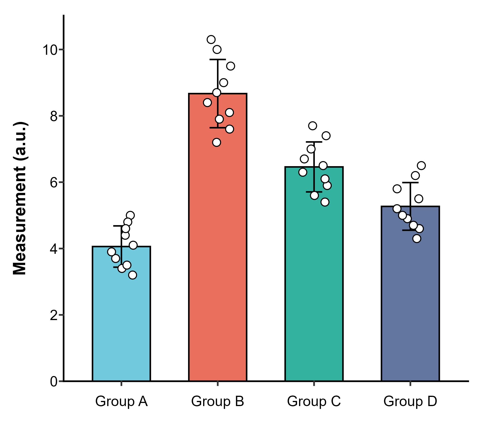
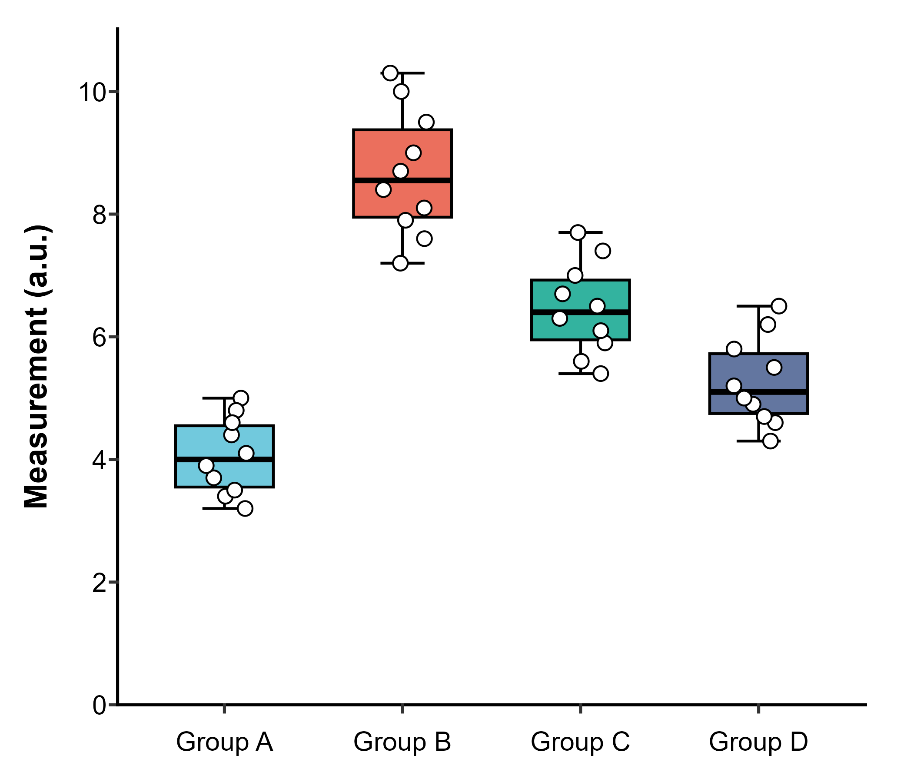
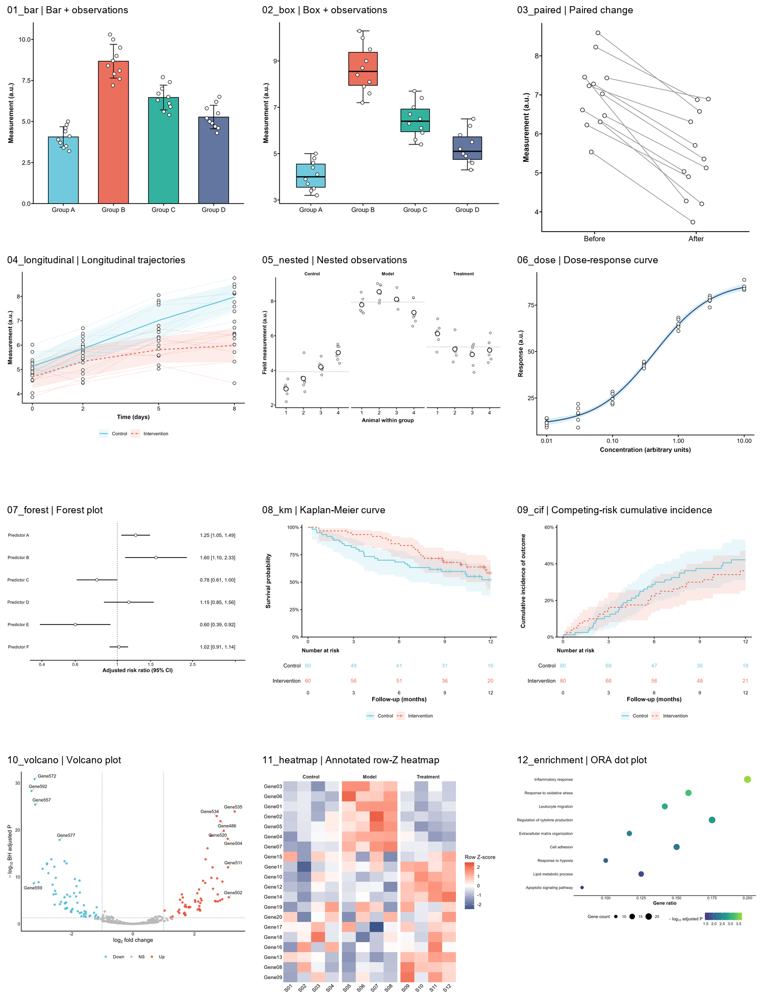
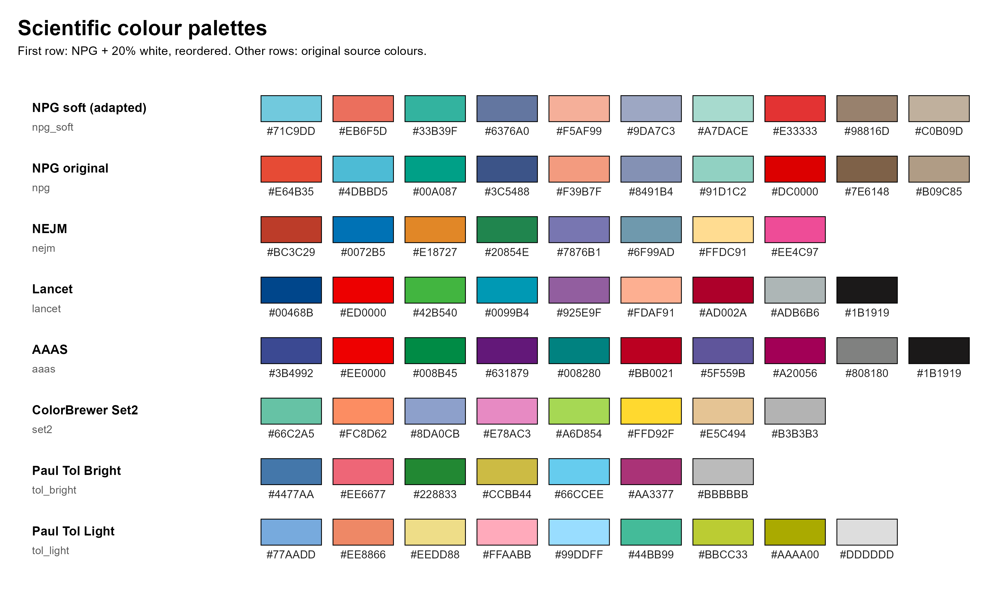

# ggplot Publication Figures

[English](README.md) | 简体中文

**用自然语言，把数据画成风格统一、可复现的科研图。**

Prism 风格 · 原始观测可见 · 8 套可复用配色 · 12 张可运行示例 · PNG / PDF / SVG

一个面向 **Codex** 的科研绘图 skill：将图形设计、R 代码、视觉检查和文件交付串成可复用的工作流，适合基础实验、临床研究和生物信息学图形。

*An agent skill for reproducible scientific figures with R and ggplot2. Prism-inspired grouped plots, visible observations, sourced colour palettes, and consistent PNG/PDF/SVG delivery.*

[快速开始](#快速开始) · [配色库](#配色库) · [使用示例](#使用示例) · [复现与交付](#复现与交付)

## 先看效果

<table>
  <tr>
    <td align="center"><b>柱状图 + 原始散点</b></td>
    <td align="center"><b>箱线图 + 原始散点</b></td>
  </tr>
  <tr>
    <td></td>
    <td></td>
  </tr>
</table>

以上示例均使用**模拟数据**，每组 10 个观测。柱状图展示均值 ± 标准差；箱线图展示中位数、四分位区间及 1.5 × IQR 范围内的须，全部观测由散点层显示。配色为 `npg_soft`，可用[示例脚本](examples/prism_style_demo.R)复现。

## 从基础实验到临床与生信图形



| 基础实验 | 临床研究 | 生信结果 |
| --- | --- | --- |
| 柱状图、箱线图与原始散点 | RR 森林图与 95% CI | 火山图与确定标签规则 |
| 配对变化与多时间点轨迹 | KM 曲线、删失标记与风险表 | 带样本分组的行 Z-score 热图 |
| 分层散点与剂量–反应曲线 | 竞争风险累积发生率与风险表 | ORA 富集点图 |

打开[完整示例图库](examples/biomedical_gallery.md)查看每张预览、模拟数据说明和代码位置。实验图保留 Prism 风格；临床和生信图形各自采用合适的效应量轴、风险表或连续色标。

规范采用按需读取的模块：[共同原则](references/core.md)、[基础实验](references/experimental.md)、[临床](references/clinical.md)、[生信](references/omics.md)、[影像指导](references/imaging.md)、[组合排版](references/composition.md)与[交付](references/delivery.md)。影像模块目前提供处理与定量显示指导，尚未包含可运行显微图或 WB 示例。

## 为什么使用这个 skill

每次向 AI 描述图形时，都重新交代圆点形状、线宽、字体、颜色和导出格式，会消耗大量时间。这个项目把这些偏好，以及科研绘图中的数据检查要求，保存在一个可以反复调用的 skill 中。

| 你关心的事 | skill 中的默认做法 |
| --- | --- |
| 图形风格稳定 | 分组测量图采用 Prism 风格：白底、黑色左轴和下轴、向外刻度、清晰文字 |
| 看得到每个观测 | 柱状图或箱线图叠加散点，统一为黑边白心圆形 |
| 配色清亮、协调 | 黑色柱体和箱体轮廓，默认 `npg_soft`，另存 7 套备选 |
| 统计含义清楚 | 标明实验单位、样本量、误差量和比较方法；配对关系按研究设计处理 |
| 改图可复现 | 固定随机布局种子，明确标签与排序规则，保留原值和展示变换记录 |
| 文件方便投稿和排版 | 同一图对象导出 PNG、PDF、SVG，并检查原尺寸和缩小后的效果 |
| 报告里显示的是新图 | 检查 Markdown / Obsidian 图片路径和同名导出文件 |

详细规范还覆盖火山图、GO / KEGG 富集图、GSEA、热图、PCA 和相关性图。不同图形使用各自合适的视觉编码；Prism 默认主题主要用于分组测量数据。

## 快速开始

### 1. 安装到 Codex

将整个仓库放入用户级 skills 目录。[Codex 的技能发现规则](https://developers.openai.com/codex/skills/)支持 `~/.agents/skills/`。

**Windows / PowerShell**

```powershell
git clone https://github.com/Bostickk/ggplot-publication-figures.git `
  "$env:USERPROFILE/.agents/skills/ggplot-publication-figures"
```

**macOS / Linux**

```bash
mkdir -p ~/.agents/skills
git clone https://github.com/Bostickk/ggplot-publication-figures.git \
  ~/.agents/skills/ggplot-publication-figures
```

已有安装的用户，保留当前安装位置并更新对应副本即可。完成后，在新的 Codex 对话中调用：

```text
使用 $ggplot-publication-figures，读取我的实验数据，
按 Prism 风格绘制带原始散点的柱状图，使用 npg_soft 配色，
标明均值和 SD，并导出 PNG、PDF、SVG。
```

### 2. 准备绘图环境

需要本地 R 环境。基础绘图使用 `ggplot2`，Prism 主题优先使用 `ggprism`：

```r
install.packages(c("ggplot2", "ggprism", "ggrepel", "patchwork", "survival", "jsonlite"))
```

具体任务可能另需 `dplyr`、`ggrepel` 等包。分组图主题提供纯 ggplot2 后备方案。skill 由 agent 读取规则、生成和执行项目代码；配色函数和示例脚本也可以直接在 R 中使用。

## 配色库

默认 **`npg_soft`**：NPG 原色混入 20% 白色，并调整为适合常见分组图的顺序。它保留了青蓝、珊瑚红、绿色和深蓝的辨识度，适合搭配黑色轮廓和白心散点。



| 名称 | 风格与适用场景 |
| --- | --- |
| **`npg_soft`** | 默认；清亮柔和的 NPG 调整版，适合柱体和箱体 |
| `npg` | NPG 原版，色感更鲜明 |
| `nejm` | 蓝、红、橙、绿对比均衡 |
| `lancet` | 深蓝与红绿搭配，对比较强 |
| `aaas` | 深色系，适合需要更强视觉对比时 |
| `set2` | 柔和多色，适合分类填充 |
| `tol_bright` | Paul Tol Bright，优先考虑色觉差异时的备选 |
| `tol_light` | Paul Tol Light，偏浅且明亮，适合带轮廓的填充区域 |

从仓库根目录运行，即可独立取色：

```r
source("scripts/publication_palettes.R")

group_order <- c("Control", "Model", "Treatment A", "Treatment B")
group_colours <- setNames(
  get_publication_palette("npg_soft", length(group_order)),
  group_order
)

# 当 ggplot 的 fill 映射到对应组名时：
# + scale_fill_manual(values = group_colours)
```

原始色值、来源与调整过程均保存在[配色指南](references/palette-guide.md)和[机器可读配色库](references/palette-bank.json)中。期刊名称表示配色灵感来源。具体图形仍应检查色觉差异、打印表现和组别区分。

## 使用示例

可以直接复制下面的需求，再补上数据路径、分组和单位。

**基础实验分组图**

```text
使用 $ggplot-publication-figures。
读取 data.csv：group 为分组，animal_id 为动物编号，value 为测量值。
每只动物为一个实验单位。绘制带散点的柱状图，显示均值 ± SD，
使用 npg_soft 配色，散点保持黑边白心圆形。保存 R 脚本和三种格式图片。
```

**比较数据分布**

```text
使用 $ggplot-publication-figures。
将分组测量值画成箱线图并叠加全部个体散点，使用 set2 配色。
明确箱体和须的定义，保留配对设计信息，标明每组有效样本量。
```

**生物信息学结果图**

```text
使用 $ggplot-publication-figures。
根据差异分析结果绘制火山图。DEG 阈值为 padj < 0.05 且 |log2FC| > 1。
按 skill 中的确定规则选择标签，固定布局种子，检查极端值和标签裁切。
```

## 复现与交付

克隆仓库后，在仓库根目录运行完整的 12 图示例：

```bash
Rscript examples/biomedical_gallery.R
```

脚本在 `examples/biomedical-output/` 中生成 12 张图的 PNG / PDF / SVG、模拟数据及分析结果 CSV、R 环境信息、图注和 manifest.json。随机数据与布局固定种子；示例分析的计算方法在代码和图注中说明。已有的双图入门示例仍可用 `Rscript examples/prism_style_demo.R` 运行。

示例已在 Windows、R 4.5.3、ggplot2 4.0.2 和 ggprism 1.0.7 环境运行。脚本使用仓库相对路径，其他平台的字体和导出设备应按本机环境检查。

对于 Markdown 或 Obsidian 报告，可以用 PowerShell 检查嵌入路径、图片大小和同名格式文件：

```powershell
pwsh -File scripts/validate_figure_delivery.ps1 `
  -ReportPath examples/biomedical-output/report.md `
  -VaultRoot .
```

实际 Obsidian 报告的 `-VaultRoot` 应指向其 vault 根目录。自动检查完成后，再查看全尺寸与约 50% 缩放后的图形，确认文字、散点、误差线和标签清晰可读。

## 项目结构

```text
ggplot-publication-figures/
├── SKILL.md                         # 简短入口与按需读取的模块
├── references/                      # 基础实验、临床、生信、影像与交付规范
│   ├── palette-guide.md
│   └── palette-bank.json
├── scripts/
│   ├── biomedical_styles.R          # Prism / clinical / omics 样式
│   ├── publication_palettes.R       # 8 套固定配色
│   └── validate_figure_delivery.ps1
├── examples/
│   ├── biomedical_gallery.R         # 完整 12 图运行入口
│   ├── biomedical_gallery.md        # 单图预览、说明与代码位置
│   ├── lib/                         # 共同导出、实验、临床、生信实现
│   └── prism_style_demo.R           # 双图入门示例
└── assets/                          # 首页色卡、概览与单图预览
```

## 来源与参与

主题与配色参考 [ggplot2](https://ggplot2.tidyverse.org/)、[ggprism](https://csdaw.github.io/ggprism/)、[ggsci](https://nanx.me/ggsci/)、[ColorBrewer](https://colorbrewer2.org/) 和 [Paul Tol](https://sronpersonalpages.nl/~pault/)。

欢迎通过 [Issues](https://github.com/Bostickk/ggplot-publication-figures/issues) 或 Pull Request 提交可复现的问题、图形改进和配色建议。报告问题时，请附最小示例数据、R 与关键包版本，以及预期效果。

项目当前尚未指定许可证。
