# Biomedical figure gallery

12 张可运行的生物医学绘图示例。所有观测和结果均为模拟，用于展示绘图样式与可复现的实现。

从仓库根目录运行：

```bash
Rscript examples/biomedical_gallery.R
```

依赖：ggplot2、ggrepel、patchwork、survival、jsonlite；ggprism 为可选主题依赖。脚本生成 `examples/biomedical-output/`：12 组 PNG/PDF/SVG、数据和结果 CSV、图注报告、manifest.json 与 R 环境信息。PNG 为 400 dpi；下面为优化后的预览。

分析与绘图在示例中分段实现，分析结果表先保存再绘图。07 直接读取示例中的模拟 RR 结果表；12 直接展示模拟 ORA 结果表。其余数值生成和估计均在代码中明示。实际研究改图沿用已确认的数据和分析结果。

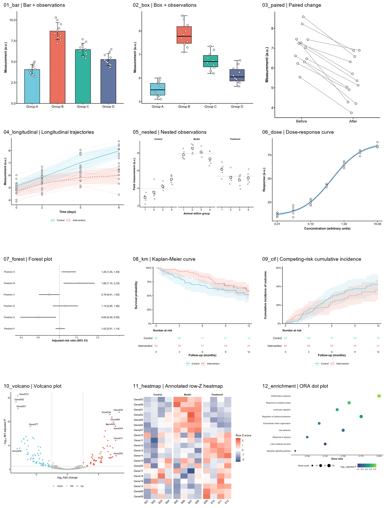

## 01 Bar with observations

分组均值与原始观测。

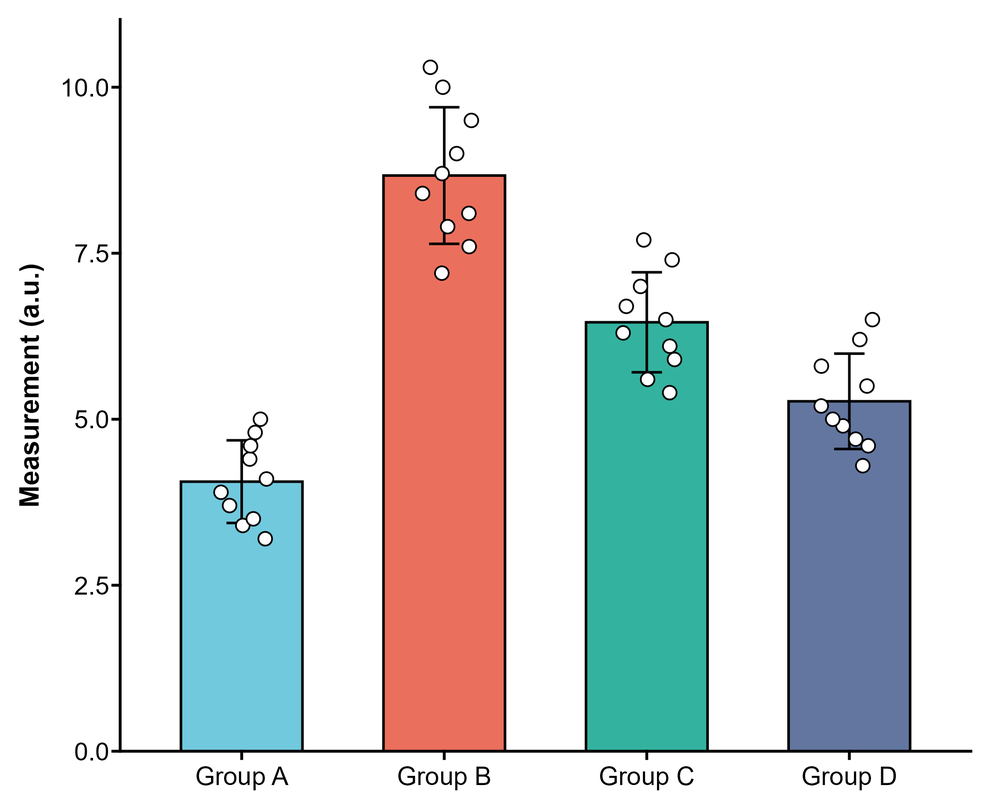

Synthetic data; n = 10 independent units per group. Bars: mean; error bars: sample SD; all 40 observations shown. Horizontal jitter only, seed 42.

实现：[lib/experimental.R](lib/experimental.R)。生成的数据/结果：`grouped_observations.csv / grouped_summary.csv`。

## 02 Box with observations

分组分布与原始观测。

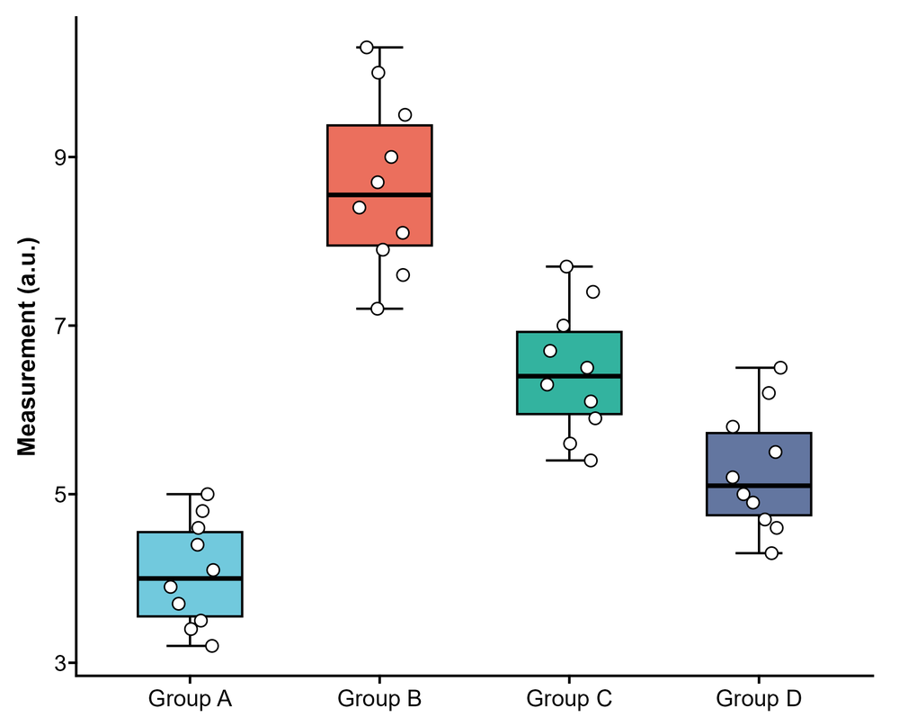

Same synthetic data as 01. Boxes: median and hinges; whiskers: most extreme observations within 1.5 x IQR. All observations shown once by the point layer.

实现：[lib/experimental.R](lib/experimental.R)。生成的数据/结果：`grouped_observations.csv`。

## 03 Paired change

同一个体的前后变化。

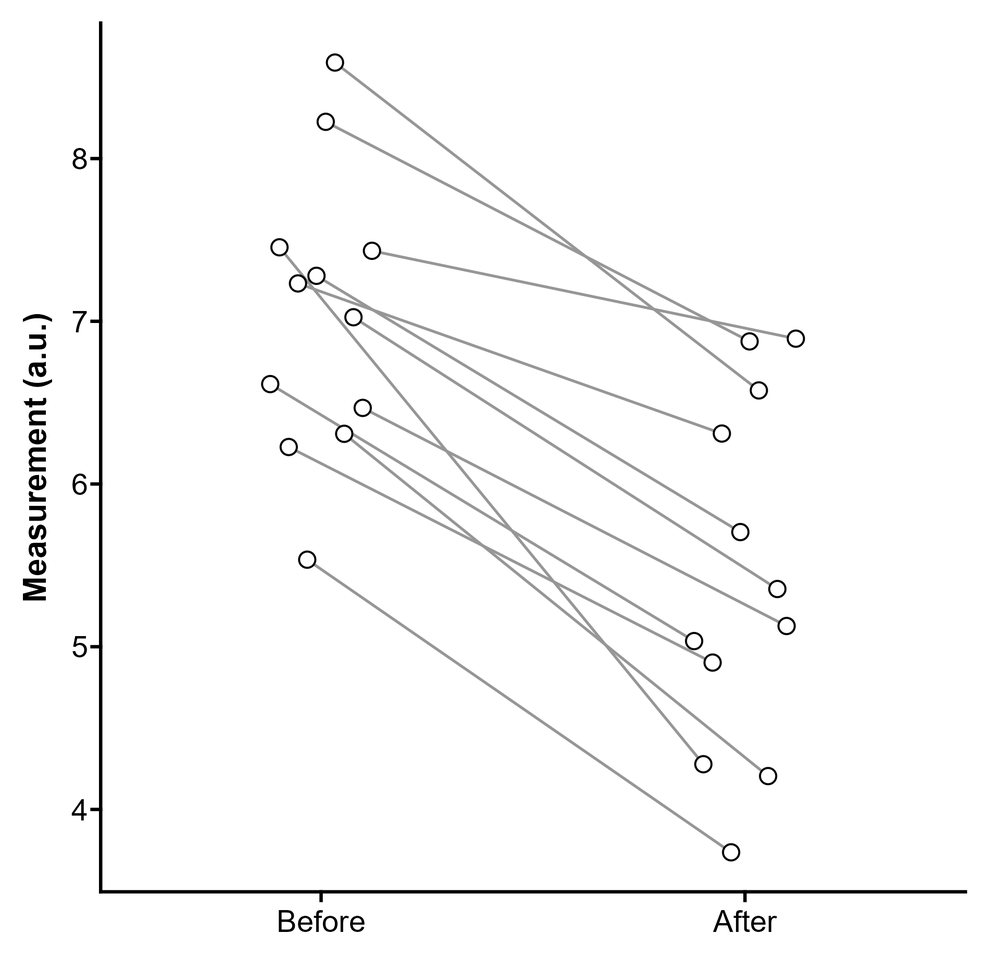

Synthetic paired measurements for 12 individuals. Each grey line joins the same individual; fixed identical horizontal offsets preserve pairing. No hypothesis test.

实现：[lib/experimental.R](lib/experimental.R)。生成的数据/结果：`paired_observations.csv`。

## 04 Longitudinal

个体轨迹、组汇总与缺失访视。

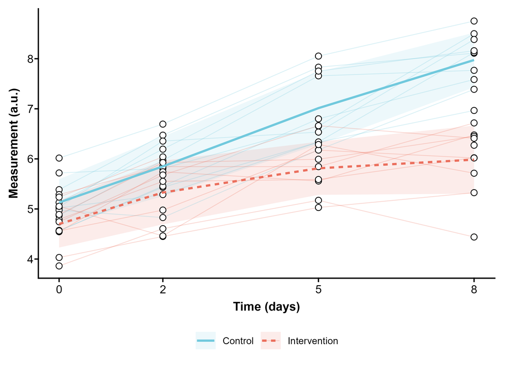

Synthetic data: 10 individuals/group, visits at 0, 2, 5 and 8 days. Thin lines: individuals; thick lines: group means; bands: descriptive mean +/- SD. L13 at day 5 is missing and its trajectory retains a gap. N by visit is in longitudinal_summary.csv.

实现：[lib/experimental.R](lib/experimental.R)。生成的数据/结果：`longitudinal_observations.csv / longitudinal_summary.csv`。

## 05 Nested observations

视野观测与各动物均值。

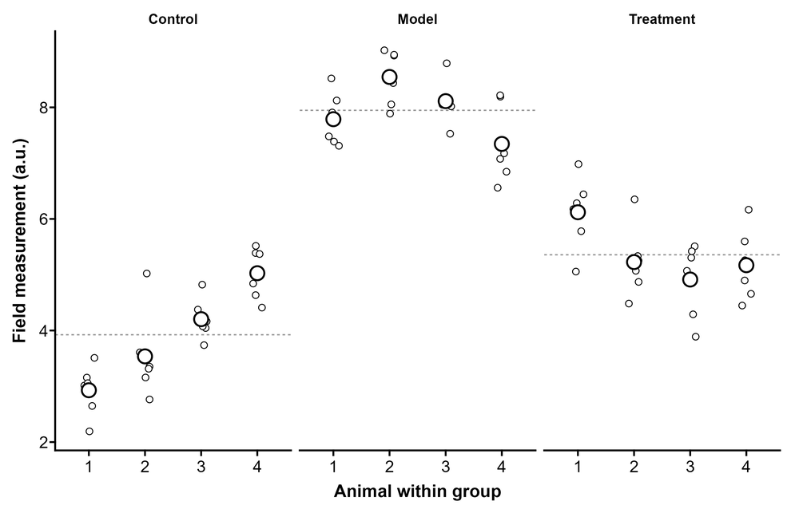

Synthetic data: 4 independent animals/group, 6 fields/animal. Small circles: fields; large circles: animal means; dashed line: mean of the four animal means in that group. Panels separate groups. No hypothesis test.

实现：[lib/experimental.R](lib/experimental.R)。生成的数据/结果：`nested_field_observations.csv / nested_animal_means.csv`。

## 06 Dose response

实际剂量、拟合曲线及均值置信区间。

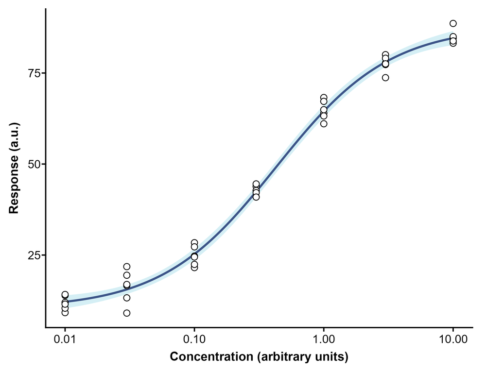

Synthetic independent measurements: 6 per positive concentration. Curve: four-parameter logistic nls fit; band: approximate 95% CI for the mean using the delta method and residual t quantile. No prediction interval or extrapolation. Fitted parameters/curve saved separately.

实现：[lib/experimental.R](lib/experimental.R)。生成的数据/结果：`dose_observations.csv / dose_fitted_curve.csv / dose_model_parameters.csv`。

## 07 Forest

已有 RR 结果与置信区间。

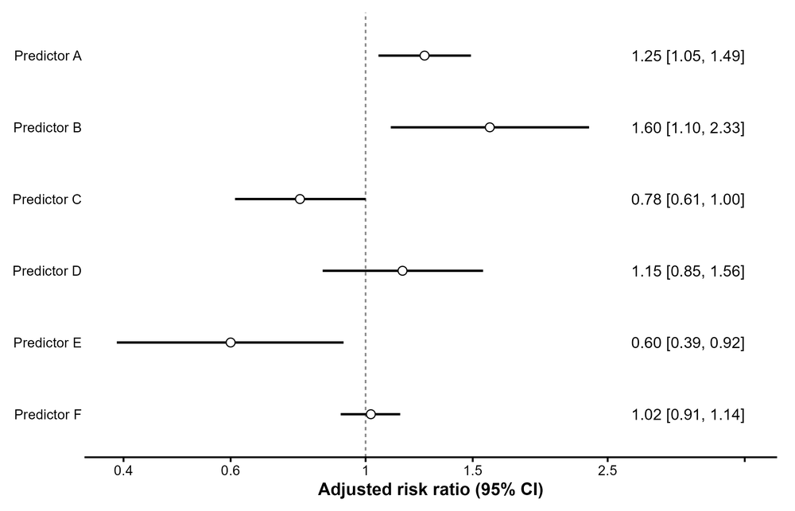

Directly supplied synthetic adjusted risk ratios and 95% confidence limits; no regression fitted. Ratio axis is logarithmic, null reference = 1. Row labels and numeric intervals correspond to the saved result table.

实现：[lib/clinical.R](lib/clinical.R)。生成的数据/结果：`forest_supplied_synthetic_results.csv`。

## 08 Kaplan Meier

单一事件生存概率、删失及风险人数。

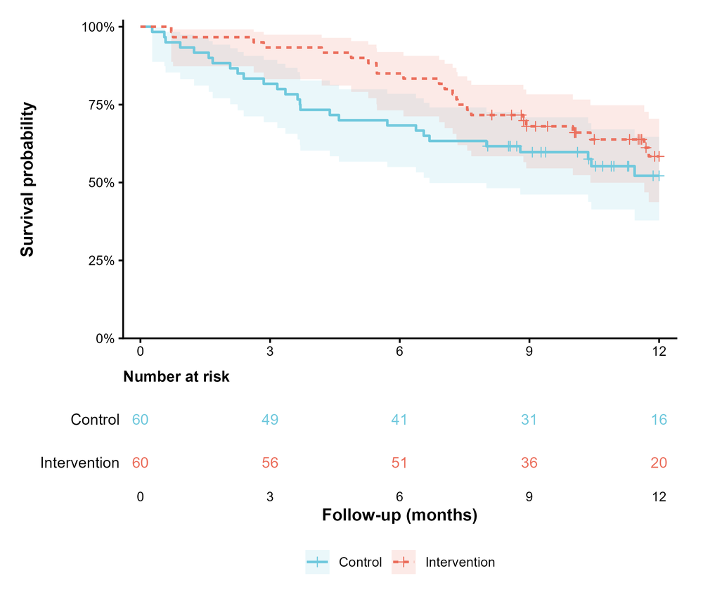

Synthetic right-censored single-event data, 60 individuals/group, common time zero; maximum follow-up 12 months. Curves: Kaplan-Meier; bands: log-log 95% CI; + marks: censoring. Risk table: time >= each displayed time. No group-comparison test.

实现：[lib/clinical.R](lib/clinical.R)。生成的数据/结果：`km_observations.csv / km_estimates.csv / km_risk_table.csv`。

## 09 Cumulative incidence

竞争死亡存在时的目标事件累积发生率。

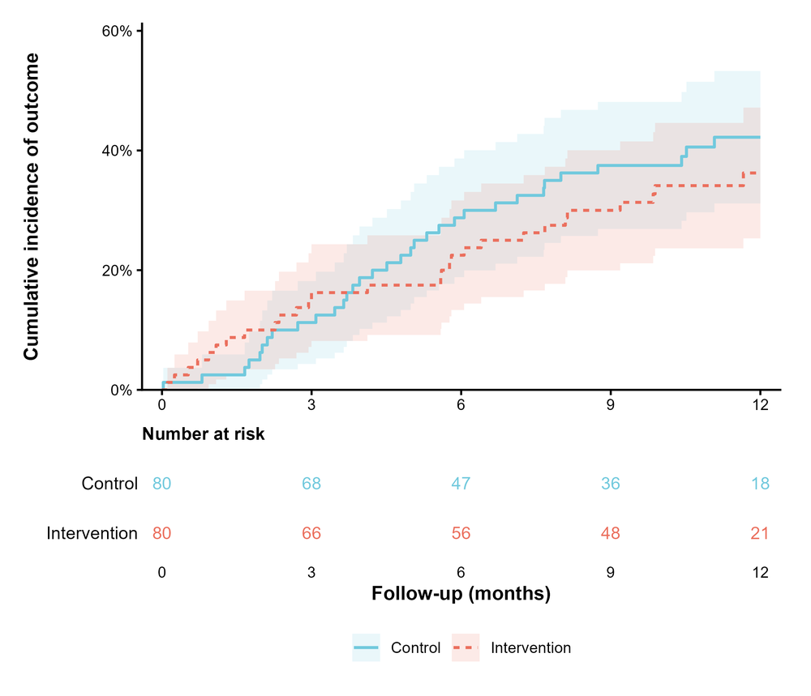

Synthetic data: 80 individuals/group; target outcome and competing death are absorbing first events, with right censoring and a common time zero. Curves: Aalen-Johansen target-event probability; bands: pointwise plain 95% CI (bounded to [0,1] by survival). Risk table counts those free of both events and uncensored immediately before each displayed time. No test or regression.

实现：[lib/clinical.R](lib/clinical.R)。生成的数据/结果：`cif_observations.csv / cif_aj_estimates.csv / cif_risk_table.csv`。

## 10 Volcano

固定阈值与确定标签规则。

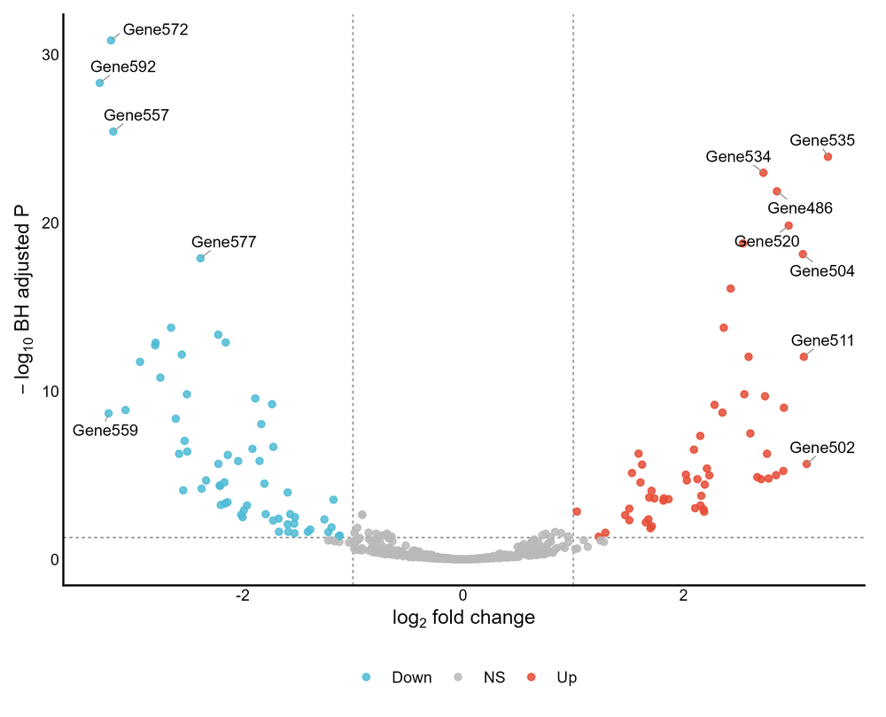

Synthetic 600-gene result table; constructed two-sided P values are BH-adjusted within the example. DEG display: adjusted P < 0.05 and |log2FC| > 1. Labels: union of top 4 per direction by adjusted P and absolute log2FC, ties by stable keys. No display capping or label cherry-picking.

实现：[lib/omics.R](lib/omics.R)。生成的数据/结果：`volcano_synthetic_results.csv / volcano_selected_labels.csv`。

## 11 Heatmap

行 Z-score、样本分组与聚类顺序。

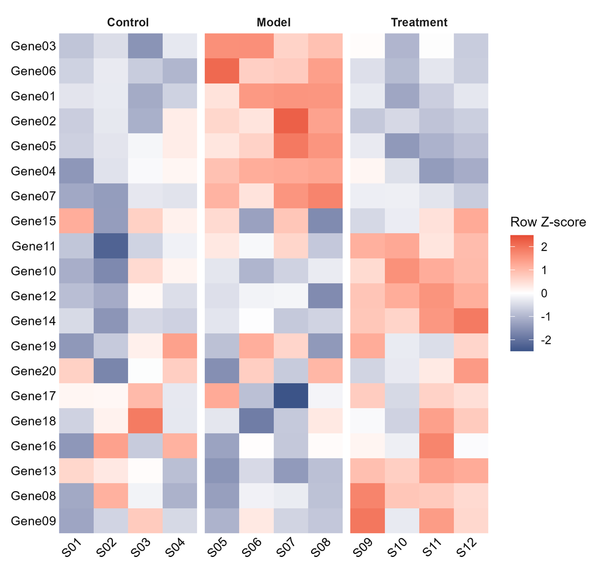

Synthetic transformed measurement matrix: 20 genes x 12 samples, 4/group. Values standardized within each row (sample SD); gene rows clustered by Euclidean distance and complete linkage. Samples retain group order. Symmetric colour limits cover all values; Z-scores encode within-gene variation, not between-gene abundance.

实现：[lib/omics.R](lib/omics.R)。生成的数据/结果：`heatmap_synthetic_matrix.csv / heatmap_row_zscores.csv / heatmap_sample_groups.csv`。

## 12 Enrichment

ORA 结果的点大小、颜色与比例语义。

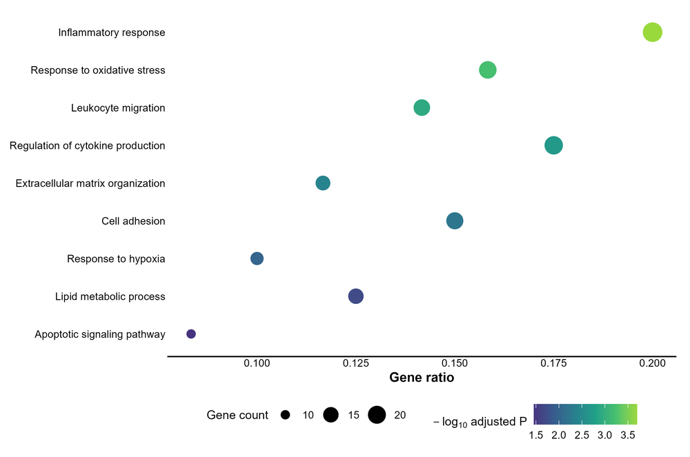

Illustrative synthetic GO biological-process-style ORA result table; no enrichment test is run and no GO identifiers are assigned. All 9 illustrative terms are shown in adjusted-P order. Ratio = count / 120 submitted genes. BP only; CC/MF and GSEA were not simulated. Values describe no biological discovery.

实现：[lib/omics.R](lib/omics.R)。生成的数据/结果：`ora_supplied_synthetic_results.csv`。

